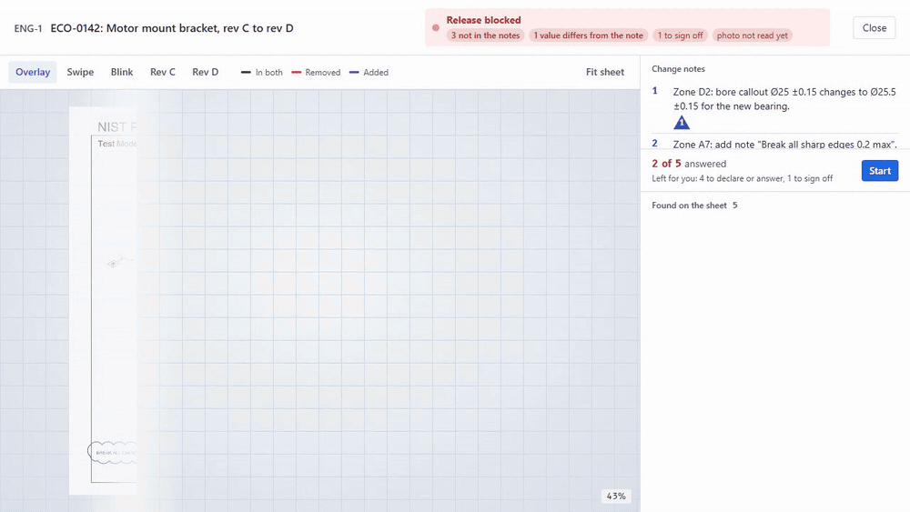
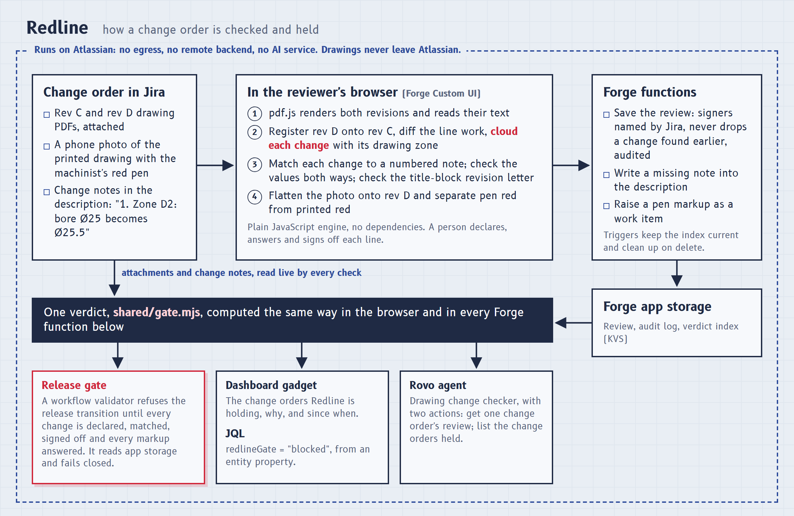

# Redline

An engineering change order says what changed on a drawing: *"bore Ø25 becomes Ø25.5"*. The drawing that comes back from the drafter often changes more than that. A hole moves, a note disappears, a tolerance tightens. Nobody writes it down, a checker comparing two prints by eye misses it, and the part gets made wrong.

Redline is a Forge app for Jira that compares a drawing's revisions on a change order (the last reviewed revision against the newest; the oldest against the newest, the first time) and does five things:

- clouds each change it finds between them, the way a drafter marks a revision, and offers a ready note for a change no note describes ("Zone C3: moved 3 mm right and down", a distance on the sheet, not on the part);
- matches each change to the numbered change notes in the description, and checks the values: if note 1 says Ø25.5 and the drawing now says Ø25.6, the release waits;
- holds the release transition until every change is declared and signed off;
- reads a phone photo of a marked-up print (the sample's photo is simulated) and lists every red-pen markup on it, so comments from the shop floor need an answer too;
- checks the title block names the revision being released.

The comparison runs in the browser inside Jira. Drawings never leave Atlassian, and the comparison calls no AI service.



It is for the people who sign off drawing changes: design checkers, quality engineers and manufacturing engineers at companies that run engineering change orders in Jira, typically hardware teams and contract manufacturers without a separate PLM system. They exist and they are asking: on Atlassian's Community, an engineer who runs change requests and change orders in Jira asked how to tie them to the drawings in SolidWorks PDM or Autodesk Vault ([May 2024](https://community.atlassian.com/forums/discussion/2705268/integrating-jira-with-solidworks-pdm-or-autodesk-vault)), noting that "lots of teams in manufacturing are using Jira, yet no out of the box integration"; an Atlassian expert replied that he knew of no app doing it, and others were still asking in 2025. An earlier thread asked for an app to manage change orders with document versions and approvals in Jira ([2021](https://community.atlassian.com/forums/discussion/1844107/eco-management-in-jira)).

## What it does in Jira

**Issue panel.** On the change order, the release verdict in one sentence: *Release blocked: 1 change on the drawing is not in the change notes.* Below it, each sheet as a small diazo print with its changes clouded in the colour of their decision, and the list of changes with who signed each one.

**Light table.** A full-screen review. The sheets light up and the clouds draw themselves where the revisions differ. You can compare the revisions as:

- an overlay, with removed ink in red and added ink in blue;
- a swipe or a blink between them;
- either revision on its own.

The ledger lists each change with before-and-after crops; a change whose content only moved says how far it moved on the sheet (*Moved 3 mm right and down*); that is paper distance, not part geometry, so the note still has to state the new dimension. Plot stamps and labels that moved without changing are grouped as housekeeping, to look over and sign together, and line work a re-export nudged by under 0.7 mm on the sheet is set aside in its own list, drawn on the sheet on request and can be counted back in. Arrow keys step through the changes, number keys declare one against a change note, and S signs it off. Multi-sheet drawings are compared sheet by sheet, and the release stays blocked until every sheet has been compared.

**Text the pixels can miss.** Where the PDF keeps its text, Redline compares the words as well as the line work, so a one-letter or one-digit edit (25.5 to 25.6, Rev A to Rev B) is a change even when it moves too little ink to see.

**Title block.** The drawing being released must name its own revision: if revision D's title block still reads Rev C, that is a change like any other, and the release waits until someone answers it. A letter that moved on as it should is grouped with the housekeeping.

**Marked-up prints.** Attach a phone photo of the printed sheet. Redline finds the sheet in the photo, flattens it onto the new revision, separates pen red from red printed on the drawing, and lists each markup. Every markup must be raised as a work item, covered by a change, or dismissed before release.

**Release gate.** A workflow validator that refuses the release transition until the review is complete. It reads the review from Redline's own app storage rather than from an issue property, re-checks that the review covers the last reviewed revision against the newest (in revision order, whatever order they were attached in; anything the previous review left unanswered or uncleared is carried in and holds), and fails closed if Jira cannot say what is attached. A sign-off is for the change note as it read when signed, so a rewritten or renumbered note needs signing again; a review that found nothing, or set line work aside as re-plot shifts, needs one person to confirm it by name; a PDF attached after the reviewed revision that Redline cannot place holds the release until it is set aside by name; an earlier photo's unanswered pen markups stay open; every numbered change note has to be carried out by a change on the drawing, or a named person says it needs no drawing change; and a change order carrying two different drawings, each with revisions, is held, since Redline compares one drawing per change order. See [Set up the release gate](docs/release-gate.md).

**Search and Rovo.** `redlineGate = "blocked"` in JQL finds blocked change orders. The *Drawing change checker* Rovo agent answers questions such as *"What changed on ENG-5, and is it declared?"*

## How it fits together



The comparison runs in the reviewer's browser, inside Jira, so drawings never leave Atlassian. Forge's content security policy allows no WebAssembly, so the engine is plain JavaScript. The server checks every save against the stored review: signer names come from Jira, a save must name the revision pair the gate expects, it can never drop a change an earlier comparison found, and every save is audited. Each sign-off records the signer's Jira name and the note's words at that moment. Anyone who can edit the work item can sign; who can release is set by Jira's transition permissions. The release gate re-reads the attachments and the change notes from Jira on every check, so a stale review cannot pass.

## How the comparison works

1. pdf.js renders both revisions in the browser at up to 300 dpi.
2. The engine registers revision B onto revision A: first moment-based alignment, then pyramid Lucas-Kanade on the line work, which also absorbs the skew and scale of a rescan.
3. It diffs ink darkness with a small positional tolerance, so anti-aliasing and rescan blur are not counted as changes.
4. It groups changed ink into blobs. On noisy scans it takes a second, contrast-blind look at each blob.
5. It merges edits within about 7 mm into one cloud and names its zone on an 8 by 6 grid laid out like an ASME drawing border (columns numbered from the right, rows lettered from the bottom), so *"Zone D2"* in a change note links to the change in D2.

A note claims a change outright only when that change is the only one in the zone it names. Anything less certain is shown as a suggestion that a person confirms. That way an undeclared edit in its own place never hides behind a declared one next to it. Two edits within about 7 mm are clouded together, as a drafter would; the crop shows both, and the value check reads the cloud's text against the note both ways (a value the drawing has that the note does not, and a value the note promises that the drawing does not show).

The engine is plain JavaScript with no dependencies: [`static/lighttable/src/engine/`](static/lighttable/src/engine/).

## On real drawings

We ran Redline on drawings nobody prepared for it: 27 consecutive revision pairs of 7 drawings from 5 SparkFun open-hardware repositories, taken from their GitHub history, with each commit message standing in for the change notes. Redline drew 365 clouds, and we classified every one: 87 are changes to parts, connections, values or notes (a jumper, test points, a regulator block, a resistor value, a USB filter removed, renamed nets). **The commit messages clearly describe 4 of the 87 and clearly miss 48;** the other 35 sit under messages too vague to tell. The per-cloud table is published. The run also taught the engine to set aside re-plot shifts (all 30 it set aside are published side by side, and each reads the same before and after) and to measure moves. Details, figures and scripts: [Redline on real drawings](docs/real-world-run.md).

## Measured on a benchmark

On 352 revision pairs we built from public-domain NIST test drawings, with edits we planted at the PDF level (so these numbers show how the engine behaves, not how often real drafters slip):

| | Result |
|---|---|
| Digital revisions | 431 of 432 visible edits found, no false clouds on unchanged sheets, 0.01 false clouds a sheet overall, about 0.3 s a sheet |
| Simulated rescans of revision B (rotated, scaled, blurred, noisy, JPEG) | 398 of 432 edits found (92.1%), about 1 false cloud a sheet |
| Simulated phone photos of marked-up prints (60 photos, 160 pen marks) | 160 of 160 marks found, no false marks, about 0.7 s a photo |

The benchmark measures the pixel comparison and the markup reader; the text-layer, title-block and housekeeping checks are covered by unit tests. The scripts, the method and the raw results are in [`bench/`](bench/). Anyone with the NIST drawings can run them again.

## For judges

Install Redline from [this installation link](https://developer.atlassian.com/console/install/1f09faad-22a5-466a-ae4c-50d4a617e754?signature=AYABeD3RzITrFn1pIkBkv0tiO6QAAAADAAdhd3Mta21zAEthcm46YXdzOmttczp1cy13ZXN0LTI6NzA5NTg3ODM1MjQzOmtleS83MDVlZDY3MC1mNTdjLTQxYjUtOWY5Yi1lM2YyZGNjMTQ2ZTcAuAECAQB4CxqLTo9l4lqXuFjNim1xJM%2Bp%2F3TVP9xHS2BrU5DRRucB821x7TGad46AHAtPDliFjQAAAH4wfAYJKoZIhvcNAQcGoG8wbQIBADBoBgkqhkiG9w0BBwEwHgYJYIZIAWUDBAEuMBEEDLvC5ST3gLEH92lsngIBEIA7cbPU1q98Os1y38UWZN7zkrc1MCmZXpQM41Y0dDYGSQhu%2FUjkXd14IeOnQp09SzzP0avUGDDGvqWNa8cAB2F3cy1rbXMAS2Fybjphd3M6a21zOmV1LXdlc3QtMTo3MDk1ODc4MzUyNDM6a2V5LzQ2MzBjZTZiLTAwYzMtNGRlMi04NzdiLTYyN2UyMDYwZTVjYwC4AQICAHi9bVMAkme4qVQX1fQHo6ePw3H40A7cGfz7yrmSfBWMXgFVg1e0wH18fS53qAGf8iU8AAAAfjB8BgkqhkiG9w0BBwagbzBtAgEAMGgGCSqGSIb3DQEHATAeBglghkgBZQMEAS4wEQQMmo2pAo8MSCrnkSI%2BAgEQgDsWI4r3n1qXSnTtWGVJmJz15MZ%2BLNmG1gdP4P%2BGfq95VJJbZs%2F44WB8x%2F%2BbM51wrnRDS3FsOvkNtCfstwAHYXdzLWttcwBLYXJuOmF3czprbXM6dXMtZWFzdC0xOjcwOTU4NzgzNTI0MzprZXkvNmMxMjBiYTAtNGNkNS00OTg1LWI4MmUtNDBhMDQ5NTJjYzU3ALgBAgIAeDYASx0XCjkny4iLV6vz%2BKtEGSGT6kdt0QRpkn6D%2FlVEAbJjkaSsnPr1PTXtQd95ln0AAAB%2BMHwGCSqGSIb3DQEHBqBvMG0CAQAwaAYJKoZIhvcNAQcBMB4GCWCGSAFlAwQBLjARBAxnoRQiFh%2BL9NrL7P4CARCAO6F%2BpoBFH2j3v7u4grdBUh7%2B1VEZN27Nh8IpgNOclYHEuXd%2Bkgqmb4RYPgTJmsbLmqkqbVGn%2BvnvSCHrAgAAAAAMAAAQAAAAAAAAAAAAAAAAAEYlYZWJYh7LaJIGrcNMeX%2F%2F%2F%2F%2F%2FAAAAAQAAAAAAAAAAAAAAAQAAADI3pg368N0zLFBVTwlq0IXiugwIX630R6q%2BvZqEvN9LOX277ZqXThyydG6YLDTAq5IYL0sgYA3N6pSbXenSJRWKKh4%3D&product=jira) (Jira Cloud, any site). Then, in about three minutes:

1. Open a throwaway work item (the sample attaches three files and adds a Change notes section to its description), select the **Apps** button under its title and choose **Redline**. The panel offers **Add a sample change order**. It attaches revisions C and D of a sample bracket drawing (a public-domain NIST test drawing, edited by us), a phone photo of a marked-up print, and two numbered change notes.
2. Select **Compare revisions**. The light table finds five changes and two pen markups. Change 1 is declared in note 1, but the drawing says Ø25.6 where the note says Ø25.5. Change 2, a hole that moved, is in no note; change 3, a datum feature removed, is in no note either. Change 4 matches note 2 and needs a sign-off. Change 5 is the title block, which still reads Rev C on the Rev D drawing. On the photo of the print, the machinist wrote "CHECK POS?" in zone D3, circling the moved hole (change 2); Redline offers change 1 because its cloud is closer, so choose change 2. "Ø3 MAX" in D7 sits where nothing changed: raise it as a work item.
3. Decide each one: press **1** or **2** to declare a change against a note, **S** to sign off, or use the buttons. On change 3, select **write it up as note 3**, type over the drafted words (for example "Zone B4: datum feature removed"), then **Add to the change notes**: the note goes into the description, marked as written in Redline. The verdict in the header updates as you go. Close the light table to see the issue panel.
4. To see the release gate, add the **Redline drawing release gate** validator to a transition (steps in [Set up the release gate](docs/release-gate.md)) and try that transition while changes are open. Jira refuses it with the reason.
5. Optional: add the **Change orders held by Redline** gadget to a dashboard, search `redlineGate = "blocked"`, or ask the *Drawing change checker* agent in Rovo.

To build and deploy it yourself:

```bash
npm install -g @forge/cli     # once; Node 22 or later
forge login
forge register                # gives your copy its own app id
npm install
cd static/lighttable && npm install && npm run build && cd ../..
forge deploy
forge install
```

`npm run dev` in `static/lighttable` runs the light table in a plain browser against the bundled sample (`?view=table`, `?view=panel`, `?sample=multi` for a three-sheet set, `?readonly=1` to play a viewer).

## Permissions

| Scope | Why |
|---|---|
| `read:jira-work` | read the change order, its description and its PDF and photo attachments, as the person using Redline |
| `write:jira-work` | attach the sample, the print photo and markup work items; add a change note to the description (only when you select **Add to the change notes**); write the searchable copy of the verdict |
| `read:jira-user` | show who signed off and who saved the review |
| `storage:app` | keep each review where only Redline can change it |

Saving a review needs permission to edit the work item. People who can only view it see the review without the controls to change it.

**Privacy:** Redline runs on Atlassian (no egress, no remote backend) and keeps its records only in Forge app storage. See [PRIVACY.md](PRIVACY.md).

## Layout

```
manifest.yml                    issue panel, dashboard gadget, workflow validator, entity property, triggers, Rovo agent and actions
src/index.js                    resolvers, release gate, Rovo actions
shared/gate.mjs                 the release verdict, shared by the browser and the validator
shared/review.mjs               signatures, re-reads and changes carried to the next revision
shared/notes.mjs                reading the numbered change notes from the description
static/lighttable/src/          the panel and light table (React), pdf.js rendering, the engine
bench/                          benchmark generator and scorers
docs/                           release gate guide, real-world run, cover
test/                           unit tests (npm test)
tools/                          sample generator, publish-revision scripts for PDM/PLM release steps
```

The sample drawings come from the NIST MBE PMI Validation and Conformance Testing project, which is in the public domain. Redline is not affiliated with NIST.
