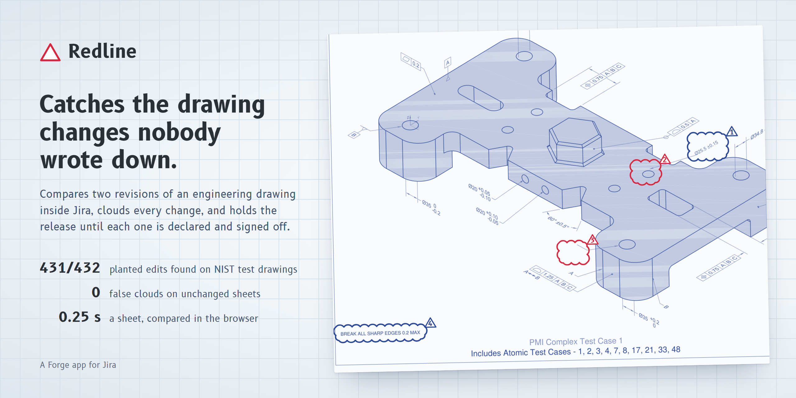

# Redline

An engineering change order says what changed on a drawing: *"bore Ø25 becomes Ø25.5"*. The drawing that comes back from the drafter often changes more than that. A hole moves 3 mm, a note disappears, a tolerance tightens. Nobody writes it down, a checker comparing two prints by eye misses it, and the part gets made wrong.

Redline is a Forge app for Jira that compares the two newest PDF revisions attached to a change order and does four things:

- clouds every change between them, the way a drafter marks a revision;
- matches each change to the numbered change notes in the description, and checks the values: if note 1 says Ø25.5 and the drawing now says Ø25.6, the release waits;
- holds the release transition until every change is declared and signed off;
- reads a phone photo of a marked-up print and lists every red-pen markup on it, so comments from the shop floor need an answer too.

The comparison runs in the browser inside Jira. Drawings never leave Atlassian, and Redline calls no AI service.

It is for the people who sign off drawing changes: design checkers, quality engineers and manufacturing engineers at companies that run engineering change orders in Jira, typically hardware teams and contract manufacturers without a separate PLM system.

## What it does in Jira

**Issue panel.** On the change order, the release verdict in one sentence: *Release blocked: 1 change on the drawing is not in the change notes.* Below it, each sheet as a small diazo print with its changes clouded in the colour of their decision, and the list of changes with who signed each one.

**Light table.** A full-screen review. The sheets light up and the clouds draw themselves where the revisions differ. You can compare the revisions as:

- an overlay, with removed ink in red and added ink in blue;
- a swipe or a blink between them;
- either revision on its own.

The ledger lists each change with before-and-after crops. Arrow keys step through the changes, number keys declare one against a change note, and S signs it off. Multi-sheet drawings are compared sheet by sheet, and the release stays blocked until every sheet has been compared.

**Marked-up prints.** Attach a phone photo of the printed sheet. Redline finds the sheet in the photo, flattens it onto revision B, separates pen red from red printed on the drawing, and lists each markup. Every markup must be raised as a work item, covered by a change, or dismissed before release.

**Release gate.** A workflow validator that refuses the release transition until the review is complete. It reads the review from Redline's own app storage rather than from an issue property, re-checks that the review covers the two newest PDFs, and fails closed if Jira cannot say what is attached. See [Set up the release gate](docs/release-gate.md).

**Search and Rovo.** `redlineGate = "blocked"` in JQL finds blocked change orders. The *Drawing change checker* Rovo agent answers questions such as *"What changed on ENG-1, and is it declared?"*

## How the comparison works

1. pdf.js renders both revisions in the browser at up to 300 dpi.
2. The engine registers revision B onto revision A: first moment-based alignment, then pyramid Lucas-Kanade on the line work, which also absorbs the skew and scale of a rescan.
3. It diffs ink darkness with a small positional tolerance, so anti-aliasing and rescan blur are not counted as changes.
4. It groups changed ink into blobs. On noisy scans it takes a second, contrast-blind look at each blob.
5. It merges edits within about 7 mm into one cloud and names its zone on an 8 by 6 grid laid out like an ASME drawing border (columns numbered from the right, rows lettered from the bottom), so *"Zone D2"* in a change note links to the change in D2.

A note claims a change outright only when that change is the only one in the zone it names. Anything less certain is shown as a suggestion that a person confirms. That way an undeclared edit can never hide behind a declared one next to it.

The engine is plain JavaScript with no dependencies: [`static/lighttable/src/engine/`](static/lighttable/src/engine/).

## On real drawings

We ran Redline on drawings nobody prepared for it: 27 consecutive revisions of five SparkFun open-hardware boards, taken from their GitHub history, with each commit message standing in for the change notes. In the 9 pairs we inspected cloud by cloud, Redline marked 25 content changes (a jumper, a test point, a pin, renamed nets, swapped connectors). **The commit messages describe 3 of them.** The run also taught the engine to set aside re-plot shifts and to measure moves. Details, figures and scripts: [Redline on real drawings](docs/real-world-run.md).

## Measured on a benchmark

On 352 revision pairs we built from public-domain NIST test drawings, with edits we planted at the PDF level (so these numbers show how the engine behaves, not how often real drafters slip):

| | Result |
|---|---|
| Digital revisions | 431 of 432 visible edits found, no false clouds on unchanged sheets, 0.01 false clouds a sheet overall, about 0.3 s a sheet |
| Simulated rescans of revision B (rotated, scaled, blurred, noisy, JPEG) | 396 of 432 edits found (91.7%), 2.7 false clouds a sheet |
| Simulated phone photos of marked-up prints (60 photos, 160 pen marks) | 160 of 160 marks found, no false marks |

The scripts and the method are in [`bench/`](bench/). Anyone with the NIST drawings can run them again.

## For judges

Install Redline from the link on the Devpost page (Jira Cloud, any site). Then, in about three minutes:

1. Open any work item, select the **Apps** button under its title and choose **Redline**. The panel offers **Add a sample change order**. It attaches revisions C and D of a sample bracket drawing (a public-domain NIST test drawing, edited by us), a phone photo of a marked-up print, and two numbered change notes.
2. Select **Compare revisions**. The light table finds four changes and two pen markups. Change 1 is declared in note 1, but the drawing says Ø25.6 where the note says Ø25.5. Changes 2 and 3 are in no note at all. The machinist circled change 2 on the print.
3. Decide each one: press **1** or **2** to declare a change against a note, **S** to sign off, or use the buttons. The verdict in the header updates as you go. Close the light table to see the issue panel.
4. To see the release gate, add the **Redline drawing release gate** validator to a transition (steps in [Set up the release gate](docs/release-gate.md)) and try that transition while changes are open. Jira refuses it with the reason.
5. Optional: add the **Change orders held by Redline** gadget to a dashboard, search `redlineGate = "blocked"`, or ask the *Drawing change checker* agent in Rovo.

To build and deploy it yourself:

```bash
npm install
cd static/lighttable && npm install && npm run build && cd ../..
forge deploy
forge install
```

`npm run dev` in `static/lighttable` runs the light table in a plain browser against the bundled sample (`?view=table`, `?view=panel`, `?sample=multi` for a three-sheet set, `?readonly=1` to play a viewer).

## Permissions

| Scope | Why |
|---|---|
| `read:jira-work` | read the change order, its description and its PDF and photo attachments, as the person using Redline |
| `write:jira-work` | attach the sample, the print photo and markup work items; write the searchable copy of the verdict |
| `read:jira-user` | show who signed off and who saved the review |
| `storage:app` | keep each review where only Redline can change it |

Saving a review needs permission to edit the work item. People who can only view it see the review without the controls to change it.

## Layout

```
manifest.yml                    issue panel, workflow validator, entity property, Rovo agent and actions
src/index.js                    resolvers, release gate, Rovo actions
shared/gate.mjs                 the release verdict, shared by the browser and the validator
static/lighttable/src/          the panel and light table (React), pdf.js rendering, the engine
bench/                          benchmark generator and scorers
docs/                           release gate guide, cover
```

The sample drawings come from the NIST MBE PMI Validation and Conformance Testing project, which is in the public domain. Redline is not affiliated with NIST.
