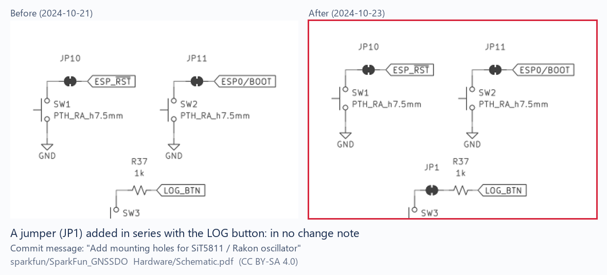
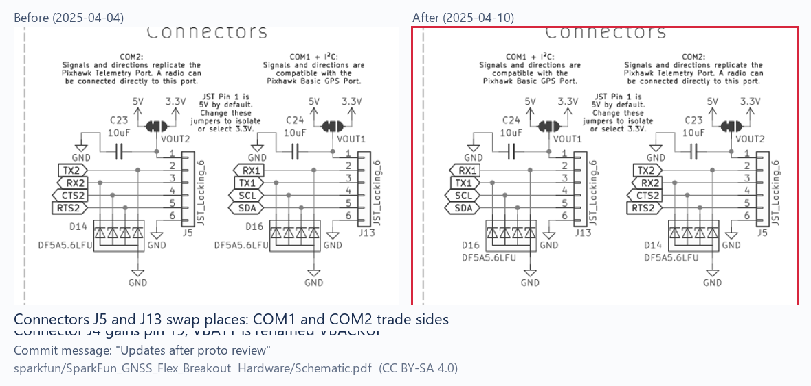

# Redline on real drawings

Everything in [the benchmark](../bench/README.md) is built by us: we planted the edits, so we know where they are. This run uses drawings nobody prepared for Redline: 7 published drawings from 5 SparkFun open-hardware repositories, every version kept in their GitHub history. The commit message on each new version plays the part of the change notes, written by the engineers who made the change.

## What we ran

- **Drawings:** 7 PDF drawings from 5 repositories (`SparkFun_GNSSDO` main board and GNSSDO Plus, `SparkFun_GNSS_Flex_Breakout`, `SparkFun_IM19_IMU_Breakout`, `SparkFun_GNSS_mosaic-G5_P3`, `SparkFun_Thing_Plus_RA6M5`), plus the GNSSDO dimensions drawing.
- **Revision pairs:** every consecutive pair of versions in git history: **27 pairs, 118 sheet pairs**, dated December 2023 to November 2025.
- **Engine:** the same comparison code the app ships, with the same thresholds. The harness renders each PDF with PyMuPDF straight to 150 dpi, where the app renders with pdf.js at 300 dpi and halves it; both compare at 150 dpi. Scripts are in [`bench/real/`](../bench/real/); anyone can clone the repositories and run them again.

## What it found

Redline drew **365 clouds** over the 27 pairs (118 sheet pairs). Three pairs produced none, and in all three the commit message describes a change that is not on the schematic (a 3D model, PCB silk, a file rename).

To check what the clouds mean, we inspected every cloud in 9 pairs (60 clouds, counted before the re-plot shift check, which now sets 5 of them aside) at full zoom, before and after side by side:

| What the cloud marks | Clouds |
|---|---|
| A content change: a part, jumper, test point or pin added, a net or reference renamed, a note added or reworded, a value changed | 25 |
| Content laid out again: blocks and labels moved, otherwise the same | 18 |
| Plot stamp from re-exporting: date, time, file path, KiCad version | 10 |
| A frame or dashed box redrawn | 2 |
| No real difference: line work nudged by a pixel in a re-export | 5 |

**Of the 25 content changes, the commit message describes 3.** The other 22 sit under messages such as "Routed", "Updates after review", "Final tweaks" or "Update to latest SparkFun KiCad Libraries". Some are exactly the kind of change Redline exists to catch:

- under "Add mounting holes for SiT5811 / Rakon oscillator": a new jumper **JP1** in series with the log button, a new test point **TP1** on the 3.3 V rail, and diode references D9 and D10 swapped (figure above);
- under "Updates after proto review": connectors **J5 and J13 trade places**, connector J4 gains a 19th pin, VBATT is renamed **VBACKUP**, and the antenna grounds are isolated (figure below);
- under "Updates after review" on the IM19 board: a jumper relabelled from "Measure JP1" to "MEAS", a net renamed from CH342_EN.1 to CH342_EN, and a new design note on the locking JST connector.

This is not a criticism of SparkFun's engineers: these are working commits in an open design, not released change orders, and commit messages are not meant to be complete. It shows how easily a revision carries more than its notes say, which is the gap a release gate has to close.

## What the real drawings taught us

Our own benchmark never re-exports a PDF; real projects do every time. Two changes to the engine came straight from this run:

1. **Re-plot shifts.** A re-exported PDF can nudge line work by a pixel or two. Redline now matches each cloud's before and after patches within about 0.7 mm, and every separate piece of ink inside the cloud on its own too, so one changed digit inside a nudged block keeps the cloud. Clouds that pass are set aside, not deleted: the app lists them under "Set aside", draws them on the sheet on request, and a reviewer can count any one back in as a change. On this run 30 of 395 clouds were set aside. We looked at all 30 side by side ([`real-world/set-aside-all.png`](real-world/set-aside-all.png), made by `bench/real/aside_sheet.py`): every one reads the same before and after. The check is deliberately cautious: small dots of ink (a decimal point, a minus sign) are always checked on their own, so two clouds where a wire was redrawn in place stay as changes rather than risk setting aside a real edit. On the planted benchmark the check cut false clouds from 0.11 to 0.01 per sheet and still found 431 of 432 edits.
2. **Moves and housekeeping.** Redline now measures moves: when the ink that disappeared reappears nearby with the same shape, the change says so, with the distance (the sample bracket's hole reads "Moved 3 mm right and down", exactly as planted; on this run, 72 of the 365 clouds measured as moves). Two kinds of difference are grouped as housekeeping: plot stamps (both texts nothing but dates, times, file paths and tool versions) and labels that moved without changing. Both need at least 90% of the changed ink to be text, so a hole that moved with its callout stays in the main list with its distance. A reviewer opens the group, looks it over, and signs the open ones together; nothing already sent back or declared is touched.

## Limits

- These are electronics schematics, not mechanical drawings. They exercise the same engine, but we have not found a public mechanical drawing with a revision history to run.
- Most of these PDFs were exported without a text layer, so the value check had little to read; the pixel comparison carried the run.
- The classification above is our own reading of each cloud; `bench/real/sheets.py` regenerates the side-by-side crops so others can check it.

Drawings © SparkFun Electronics, published under [CC BY-SA 4.0](https://creativecommons.org/licenses/by-sa/4.0/) in the repositories named above. The figures on this page are cropped from them and annotated by us (red frames, captions); as adaptations they are shared under the same licence, CC BY-SA 4.0. The rest of this repository is under its own licence.
